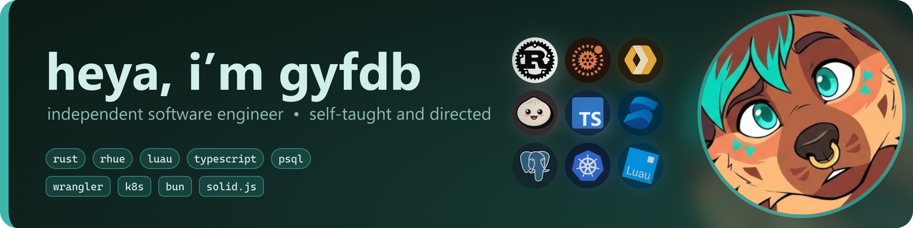
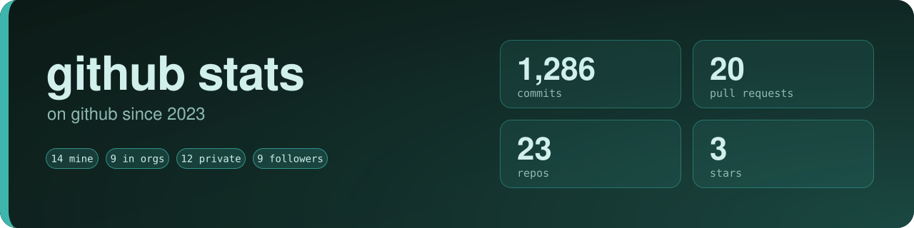
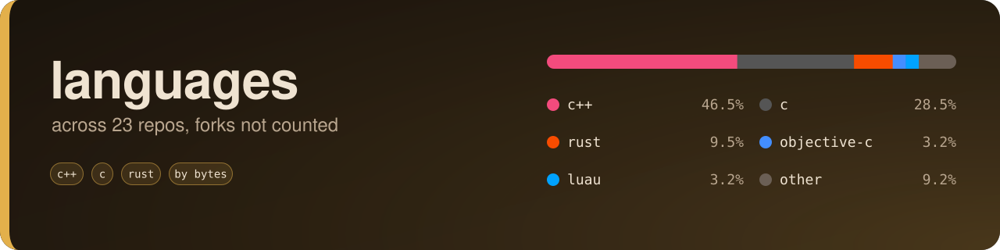
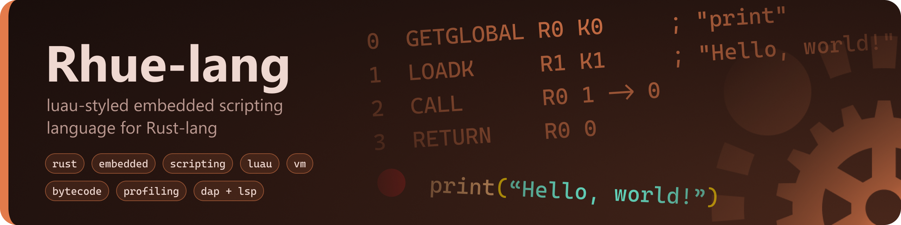
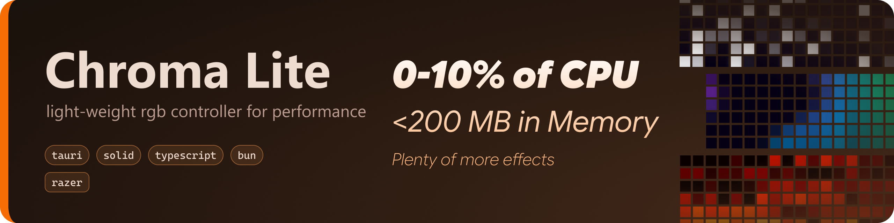
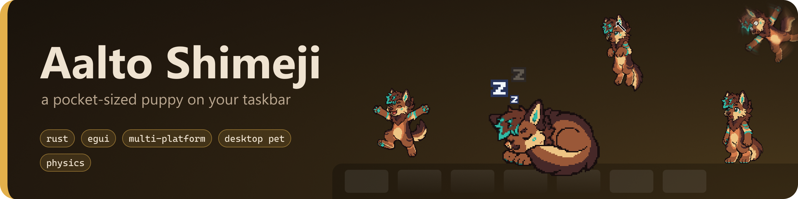

Independent dev out of New York. I mostly write Rust, a lot of Luau/Rhue, and whatever silly Typescript project I can think of. Most of my projects come from one place: **spite**. I use something, and I feel like I could do something better.

I'm also a furry of nearly a decade and pocket-sized Aalto can't stop messing with my cursor.

#### stats

#### languages

  
  
  
  
  

#### frameworks

  
  
  
  
  

#### tools

  
  
  
  
  
  
  
  

# stuff i'm working on

---

Rhue started because I wanted Luau's syntax in my Rust projects without dragging a whole Luau VM along with it. It's an embeddable scripting language with gradual typing (`--!strict` and all), compiled to register bytecode instead of walking a tree. Embedding should be as easy as Rhai: register a function, derive `UserData` on a struct, done. It's also getting a profiler and DAP + LSP support, so you're not debugging with print statements.

**[rhue.dev](https://rhue.dev)** · [rhuelang/rhue](https://github.com/rhuelang/rhue)

---

I got tired of Synapse sitting in the background eating CPU just so my keyboard could glow, so I made my own. Chroma Lite stays around 0-10% CPU and under 200 MB of memory, and turns the lights off when the PC goes idle. Effects stack as layers you can drag around, fire gets custom palettes, and more effects keep showing up.

**[chroma.typicalpuppyboy.com](https://chroma.typicalpuppyboy.com)** · [gyfdb/chroma-lite](https://github.com/gyfdb/chroma-lite)

---

A pocket-sized Aalto that lives on your desktop. He walks your taskbar, climbs window edges, naps when he gets bored, and goes flying if you grab and throw him. Written in Rust with egui and some actual physics, so the throws feel right. Runs on Windows, macOS and Linux (X11 only, no Wayland planned).

**[shimeji.typicalpuppyboy.com](https://shimeji.typicalpuppyboy.com)**

#### other stuff

Plus a pile of Cloudflare Workers (status page, short links, webmail, a scanner IP banner) because apparently I can't stop. Also poking at [OpenIDEA](https://github.com/l0ng-ai/openidea) plugins.

---

# where else

- [typicalpuppyboy.com](https://typicalpuppyboy.com)
- [zae@barkafterbark.com](mailto:zae@barkafterbark.com)

Starting Computer Science Associates Degree in Spring 2027, open to internships
